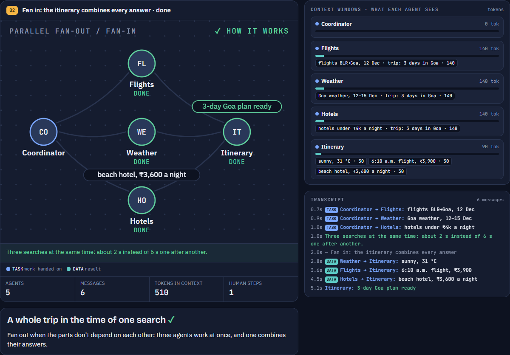
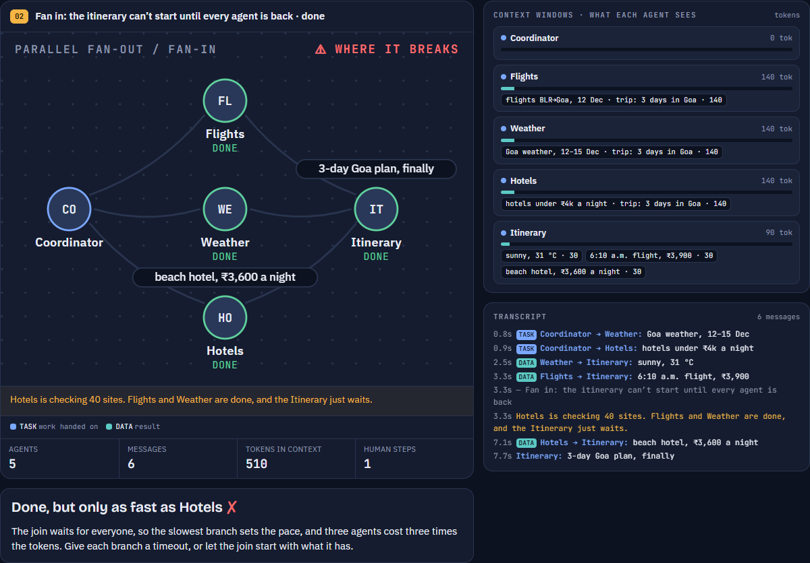
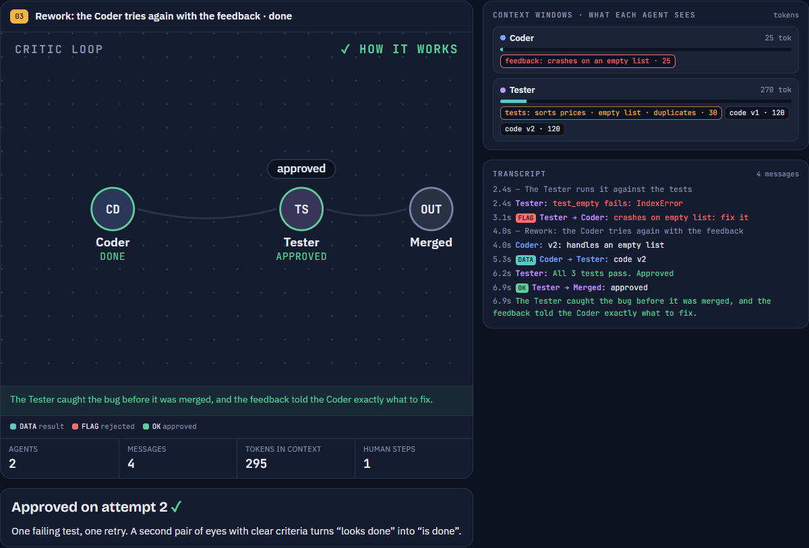
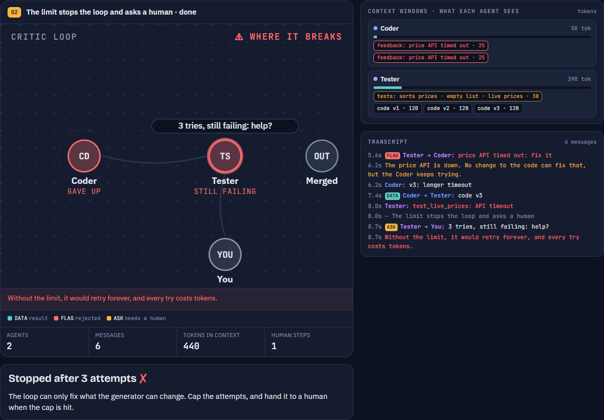
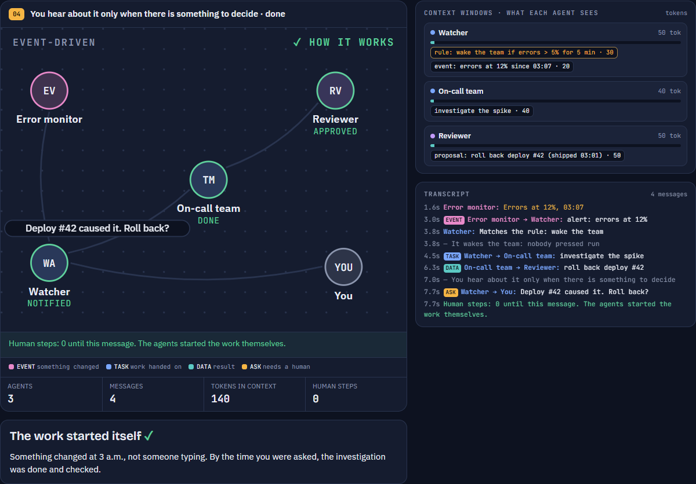
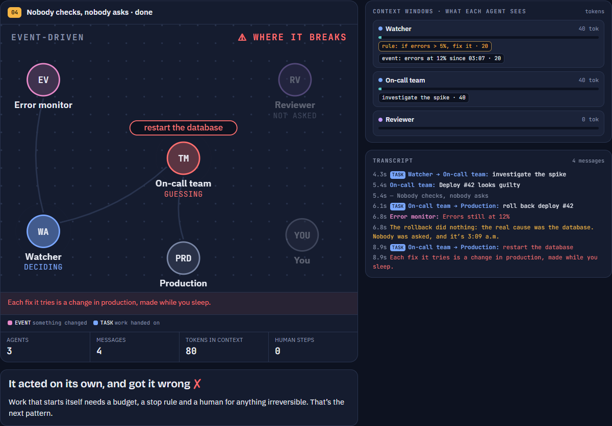

# Multi-Agent Patterns in LangGraph & CrewAI

A hands-on session on how AI agents coordinate. Watch eight coordination patterns play out step by step, then run
four of them as real agents in [LangGraph](https://github.com/langchain-ai/langgraph) and
[CrewAI](https://github.com/crewAIInc/crewAI) on a shopping task, where a grader scores what each one buys.

<p align="center">
  
</p>

## What you'll see

**Eight coordination patterns, animated.** Each one plays twice on an everyday task: first **how it works**, then
**where it breaks**. Watch messages move between agents, and see what lands in each agent's context window and how
many tokens it costs.

| | ✓ How it works | ⚠ Where it breaks |
|---|---|---|
| **Parallel fan-out / fan-in** |  |  |
| **Critic loop** |  |  |
| **Event-driven** |  |  |

**The live demo runs real LangGraph graphs and CrewAI crews.** Here Level 2 sends three scouts to the stores in
parallel, and the critic rejects a fake reseller before anything is bought:


## Quick start

Python 3.10+ (3.10–3.13 if you want the CrewAI extras; see below). No API key needed: by default the agents use
scripted replies.

```bash
python -m venv .venv
.venv\Scripts\activate            # Windows  (macOS/Linux: source .venv/bin/activate)
pip install -r requirements.txt
python app.py
```

This opens the talk at **http://127.0.0.1:8700**: pattern animations, LangGraph and CrewAI code tours, and a live
demo where you pick the framework, the brain (scripted or Claude) and the world (demo stores or real sites).
`Ctrl+C` stops it.

## Optional extras

| Want | Do |
|---|---|
| CrewAI version | `pip install -r requirements-crewai.txt` (needs Python 3.10–3.13) |
| Real listings from Amazon.in, Flipkart, Myntra | `pip install -r requirements-live.txt` (uses your Chrome) |
| Claude as the brain, no API key | Install [Claude Code](https://claude.com/claude-code) and run `claude` once to log in |
| Other settings | Copy `.env.example` to `.env` |

## The four patterns

By default the agents shop for **"Black running shoes, size 9, under ₹1,000"** across three demo stores. Nothing is
ever really bought. The grader checks four things: black running shoe · size 9 in stock · under ₹1,000 · genuine
seller.

| Level | Pattern | Bought | Score | Why |
|---|---|---|---|---|
| L0 | **Pipeline**: search → filter → pick | Black canvas slip-on · ₹499 | 2/4 | Takes the cheapest "black"; nobody checks type or size |
| L1 | **Planner → workers** | "Sparx" running shoe · ₹699 | 3/4 | Checks type and size, but not the seller: it's a fake |
| L2 | **Team + critic** (parallel scouts, rework loop) | Asian Wonder running shoe · ₹979 | 4/4 | A critic rejects the unverified seller; the evaluator picks again |
| L3 | **Event-driven** (a price drop wakes the team) | Sparx running shoe · ₹849 | 4/4 | ₹130 cheaper, no human steps, and it asks before buying |

Each level is more autonomous and spends more tokens. The code is in `patterns/` (LangGraph) and `crews/` (CrewAI).
Press **Run all four** in the live demo and the scoreboard fills in:


**Your own query:** the shoe query is the default, but any query with a colour, a type (`running` or `casual`), an
optional size and a budget works on the demo stores. Type it in the Query box on the page, or
`python search.py --query "Grey running shoes, size 9, under ₹800"`. The grader builds its checks from your query.

Level 2 in a few lines (`patterns/l2_team.py`):

```python
g.add_conditional_edges("lead", fan_out, ["scout"])                         # fan out: one scout per store
g.add_edge("scout", "evaluator")                                            # fan in: waits for every scout
g.add_conditional_edges("evaluator", after_evaluator, ["critic", "checkout"])
g.add_conditional_edges("critic", after_critic, ["evaluator", "checkout"])  # rejected? pick again
```

**Try this:** in `patterns/l2_team.py`, make `after_evaluator()` return `"checkout"` instead of `"critic"`.
What does Level 2 buy now?

## Other ways to run it

```bash
python search.py                  # the four patterns in the terminal  (--help for options)
python run.py                     # optional extra: guardrails, crash/resume/rewind demo  (--help)
python -m pytest -q               # tests, offline
```

To start with Claude as the brain: `LAB_LLM=claude LAB_MODEL=haiku python app.py`
(PowerShell: `$env:LAB_LLM="claude"; $env:LAB_MODEL="haiku"; python app.py`), or pick it on the page.

## Further practice: notebooks

These are practice notebooks. Start with the demo itself, step by step, in either framework. Both notebooks are
standalone, like 01–03: they define their own stores, tools and grader, and need only their framework and an LLM
key (set in the **Choose your LLM** cell).

| Notebook | Framework | What you see |
|---|---|---|
| `04_shopping_patterns_langgraph` | LangGraph | State, nodes and edges; `Send` and reducers; a critic loop; a subgraph and `interrupt()` |
| `05_shopping_patterns_crewai` | CrewAI | Agents, tasks and crews; async tasks; a guardrail as the critic; a `Flow` |

```bash
pip install jupyterlab
jupyter lab notebooks/          # each notebook installs its own framework in its first cell
```

Then build your own research team. Claude's Research mode is a multi-agent system: a lead agent plans and
sends subagents to work in parallel. Two notebooks build the same small version of it, one per framework, like
04 and 05. The agents answer from the model's own knowledge, so all you need is an LLM key. Both run locally or
in Google Colab.

| Notebook | Agents | What you see |
|---|---|---|
| `07_deep_research_crewai` [](https://colab.research.google.com/github/Jaskamalkainth/Multi-Agent-Patterns/blob/main/notebooks/07_deep_research_crewai.ipynb) | Lead → researchers in parallel → writer | **Start here.** About 50 lines of CrewAI, in the style of notebook 01; the new idea is `async_execution=True`. In Colab, setup is two short forms and the topic, team size and parallel switch are form fields |
| `06_deep_research_langgraph` [](https://colab.research.google.com/github/Jaskamalkainth/Multi-Agent-Patterns/blob/main/notebooks/06_deep_research_langgraph.ipynb) | Lead → researchers in parallel → review loop → writer | The same team in LangGraph: `Send` and a reducer for the parallel researchers, a conditional edge for the review loop. Adds a citation check, timeline charts, a live prompt editor and a quiz |

Then three small CrewAI projects to try on your own after the session. Each runs top to bottom.

| Notebook | Agents | What you learn |
|---|---|---|
| `01_article_writer.ipynb` | Planner → Writer → Editor | A sequential crew; each task's output feeds the next |
| `02_customer_support.ipynb` | Support rep + QA reviewer | Tools, delegation, memory |
| `03_financial_analysis.ipynb` | Analyst, strategist, trade and risk advisors | `Process.hierarchical`: a manager agent delegates |

These need Python 3.10–3.13, like the CrewAI version of the demo.

```bash
pip install -r requirements-crewai.txt jupyterlab
jupyter lab notebooks/
```

In the **Choose your LLM** cell, set `PROVIDER` (`gemini`, `openai`, `anthropic`, `openrouter`, `groq` or `ollama`)
and paste its key. Two providers have free keys: Gemini from [Google AI Studio](https://aistudio.google.com/api-keys)
and Groq from [console.groq.com/keys](https://console.groq.com/keys) (it runs `openai/gpt-oss-20b`, and its free
tier has per-minute limits, so the notebooks retry when it answers 429). Ollama needs no key at all.

**More ideas to try in this repo:** add a ₹599 "Campus" shoe from an unverified seller to `data/shoes.json` and
see which levels buy it, or give L1 a seller-check worker and compare its token cost to L2.

## Project layout

```
app.py        the talk + live demo
search.py     the four patterns in the terminal
run.py        the guardrails lab in the terminal
patterns/     LangGraph versions        crews/   CrewAI versions
lab/          guardrails lab, Claude bridge, servers
web/          the talk and demo pages
data/         demo stores and a recorded live collection
notebooks/    the demo as a notebook, build-your-own deep research, CrewAI practice notebooks
tests/
docs/         README screenshots
```

Run output (logs, checkpoints, live collections) goes to `output/`, which git ignores.

## Troubleshooting

| Problem | Fix |
|---|---|
| Port 8700 in use | `python app.py --port 8800 --live-port 8801` |
| CrewAI or Live sites greyed out | Install the matching `requirements-*.txt` |
| `pip install -r requirements-crewai.txt` fails with "No matching distribution found for crewai==1.15.28" | You're on Python 3.14+. CrewAI 1.15.28 declares `Requires-Python: >=3.10,<3.14` ([PyPI](https://pypi.org/project/crewai/1.15.28/), [CrewAI install docs](https://docs.crewai.com/en/installation)). Make the venv with 3.13 or older: `py -3.13 -m venv .venv` (macOS/Linux: `python3.13 -m venv .venv`) |
| "claude CLI not found" | Install Claude Code and run `claude` once, or set `CLAUDE_BIN` |
| A store shows "no listings read" | The site blocked the browser. Retry, or use **Live · recording** |
