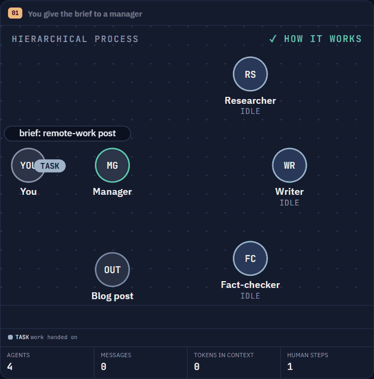
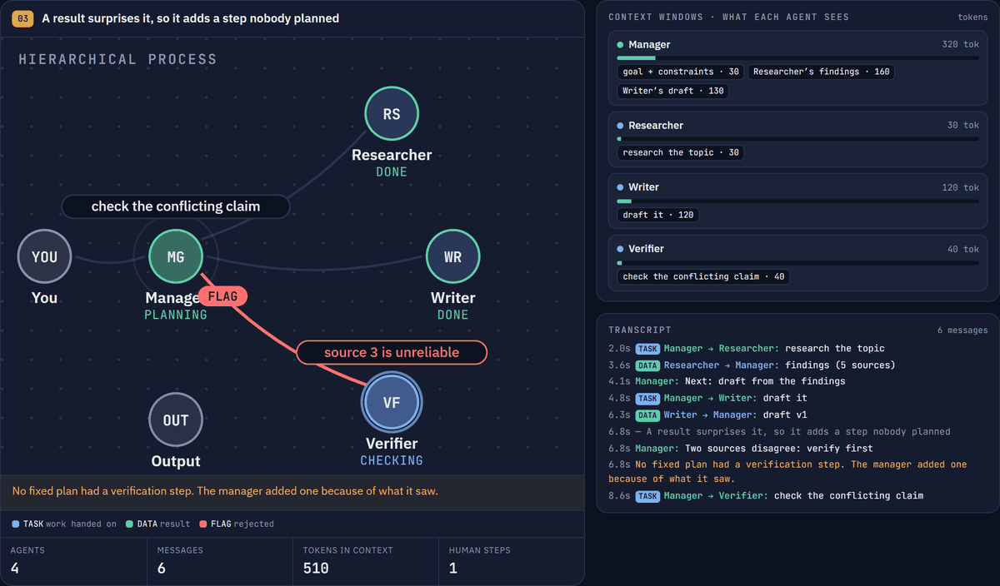
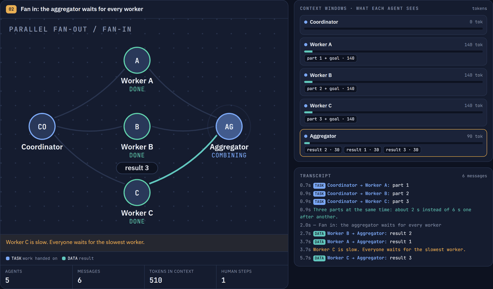
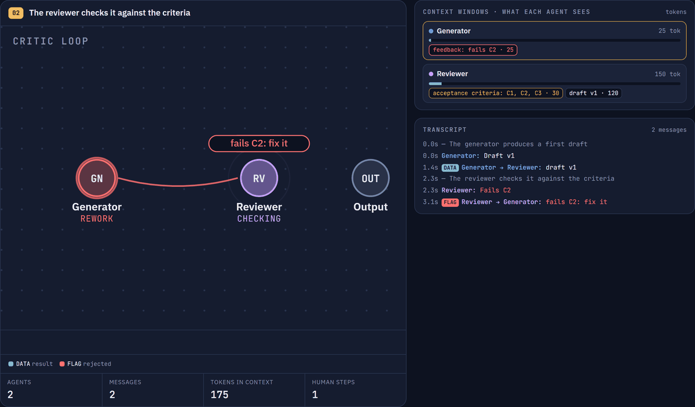
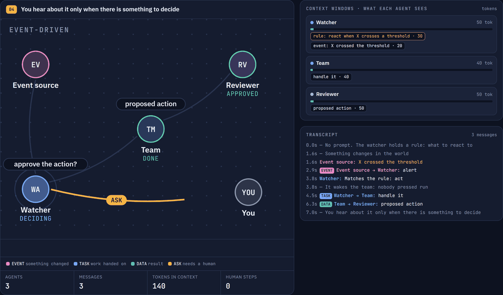
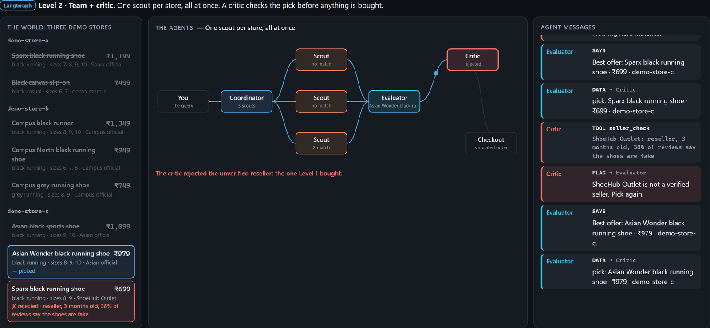
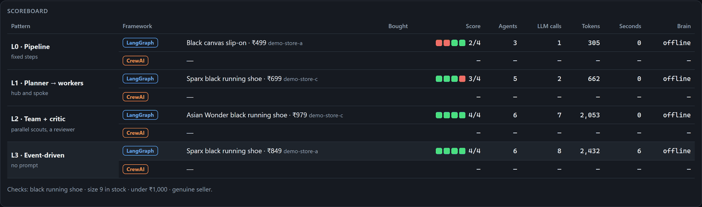

# Multi-Agent Patterns in LangGraph & CrewAI

A hands-on session on how AI agents coordinate. Watch eight coordination patterns play out step by step, then run
four of them as real agents in [LangGraph](https://github.com/langchain-ai/langgraph) and
[CrewAI](https://github.com/crewAIInc/crewAI) on a shopping task, where a grader scores what each one buys.

<p align="center">
  
</p>

## What you'll see

**Eight coordination patterns, animated.** Watch messages move between agents, and see what lands in each agent's
context window and how many tokens it costs.

| Hierarchical process | Parallel fan-out / fan-in |
|---|---|
|  |  |
| **Critic loop** | **Event-driven** |
|  |  |

**The live demo runs real LangGraph graphs and CrewAI crews.** Here Level 2 sends three scouts to the stores in
parallel, and the critic rejects a fake reseller before anything is bought:



## Quick start

Python 3.10+ (3.10–3.13 if you want the CrewAI extras; see below). No API key needed: by default the agents use
scripted replies.

```bash
python -m venv .venv
.venv\Scripts\activate            # Windows  (macOS/Linux: source .venv/bin/activate)
pip install -r requirements.txt
python app.py
```

This opens the talk at **http://127.0.0.1:8700**: pattern animations, LangGraph and CrewAI code tours, and a live
demo where you pick the framework, the brain (scripted or Claude) and the world (demo stores or real sites).
`Ctrl+C` stops it.

## Optional extras

| Want | Do |
|---|---|
| CrewAI version | `pip install -r requirements-crewai.txt` (needs Python 3.10–3.13) |
| Real listings from Amazon.in, Flipkart, Myntra | `pip install -r requirements-live.txt` (uses your Chrome) |
| Claude as the brain, no API key | Install [Claude Code](https://claude.com/claude-code) and run `claude` once to log in |
| Other settings | Copy `.env.example` to `.env` |

## The four patterns

By default the agents shop for **"Black running shoes, size 9, under ₹1,000"** across three demo stores. Nothing is
ever really bought. The grader checks four things: black running shoe · size 9 in stock · under ₹1,000 · genuine
seller.

| Level | Pattern | Bought | Score | Why |
|---|---|---|---|---|
| L0 | **Pipeline**: search → filter → pick | Black canvas slip-on · ₹499 | 2/4 | Takes the cheapest "black"; nobody checks type or size |
| L1 | **Planner → workers** | "Sparx" running shoe · ₹699 | 3/4 | Checks type and size, but not the seller: it's a fake |
| L2 | **Team + critic** (parallel scouts, rework loop) | Asian Wonder running shoe · ₹979 | 4/4 | A critic rejects the unverified seller; the evaluator picks again |
| L3 | **Event-driven** (a price drop wakes the team) | Sparx running shoe · ₹849 | 4/4 | ₹130 cheaper, no human steps, and it asks before buying |

Each level is more autonomous and spends more tokens. The code is in `patterns/` (LangGraph) and `crews/` (CrewAI).
Press **Run all four** in the live demo and the scoreboard fills in:



**Your own query:** the shoe query is the default, but any query with a colour, a type (`running` or `casual`), an
optional size and a budget works on the demo stores. Type it in the Query box on the page, or
`python search.py --query "Grey running shoes, size 9, under ₹800"`. The grader builds its checks from your query.

Level 2 in a few lines (`patterns/l2_team.py`):

```python
g.add_conditional_edges("lead", fan_out, ["scout"])                         # fan out: one scout per store
g.add_edge("scout", "evaluator")                                            # fan in: waits for every scout
g.add_conditional_edges("evaluator", after_evaluator, ["critic", "checkout"])
g.add_conditional_edges("critic", after_critic, ["evaluator", "checkout"])  # rejected? pick again
```

**Try this:** in `patterns/l2_team.py`, make `after_evaluator()` return `"checkout"` instead of `"critic"`.
What does Level 2 buy now?

## Other ways to run it

```bash
python search.py                  # the four patterns in the terminal  (--help for options)
python run.py                     # optional extra: guardrails, crash/resume/rewind demo  (--help)
python -m pytest -q               # tests, offline
```

To start with Claude as the brain: `LAB_LLM=claude LAB_MODEL=haiku python app.py`
(PowerShell: `$env:LAB_LLM="claude"; $env:LAB_MODEL="haiku"; python app.py`), or pick it on the page.

## Practice notebooks

`notebooks/` has five practice Jupyter notebooks to keep for reference after the session. Each one is standalone and
runs top to bottom.

| Notebook | Framework | What you learn |
|---|---|---|
| `01_article_writer` | CrewAI | A sequential crew (Planner → Writer → Editor): each task's output feeds the next |
| `02_customer_support` | CrewAI | Tools, delegation and memory, with a support rep and a QA reviewer |
| `03_financial_analysis` | CrewAI | `Process.hierarchical`: a manager agent delegates to analyst, strategist, trade and risk advisors |
| `04_shopping_patterns_langgraph` | LangGraph | The shoe demo step by step: state, nodes and edges; `Send` and reducers; a critic loop; a subgraph and `interrupt()` |
| `05_shopping_patterns_crewai` | CrewAI | The same demo in CrewAI: agents, tasks and crews; async tasks; a guardrail as the critic; a `Flow` |

```bash
pip install -r requirements-crewai.txt jupyterlab   # CrewAI needs Python 3.10–3.13
jupyter lab notebooks/
```

Notebooks 04 and 05 install their own framework in their first cell. In each notebook's **Choose your LLM** cell,
set `PROVIDER` (`gemini`, `openai`, `anthropic`, `openrouter` or `ollama`) and paste its key. Gemini has a free key
from [Google AI Studio](https://aistudio.google.com/api-keys); Ollama needs no key at all.

**More ideas to try in this repo:** add a ₹599 "Campus" shoe from an unverified seller to `data/shoes.json` and
see which levels buy it, or give L1 a seller-check worker and compare its token cost to L2.

## Project layout

```
app.py        the talk + live demo
search.py     the four patterns in the terminal
run.py        the guardrails lab in the terminal
patterns/     LangGraph versions        crews/   CrewAI versions
lab/          guardrails lab, Claude bridge, servers
web/          the talk and demo pages
data/         demo stores and a recorded live collection
notebooks/    practice Jupyter notebooks
tests/
docs/         README screenshots
```

Run output (logs, checkpoints, live collections) goes to `output/`, which git ignores.

## Troubleshooting

| Problem | Fix |
|---|---|
| Port 8700 in use | `python app.py --port 8800 --live-port 8801` |
| CrewAI or Live sites greyed out | Install the matching `requirements-*.txt` |
| `pip install -r requirements-crewai.txt` fails with "No matching distribution found for crewai==1.15.28" | You're on Python 3.14+. CrewAI 1.15.28 declares `Requires-Python: >=3.10,<3.14` ([PyPI](https://pypi.org/project/crewai/1.15.28/), [CrewAI install docs](https://docs.crewai.com/en/installation)). Make the venv with 3.13 or older: `py -3.13 -m venv .venv` (macOS/Linux: `python3.13 -m venv .venv`) |
| "claude CLI not found" | Install Claude Code and run `claude` once, or set `CLAUDE_BIN` |
| A store shows "no listings read" | The site blocked the browser. Retry, or use **Live · recording** |
