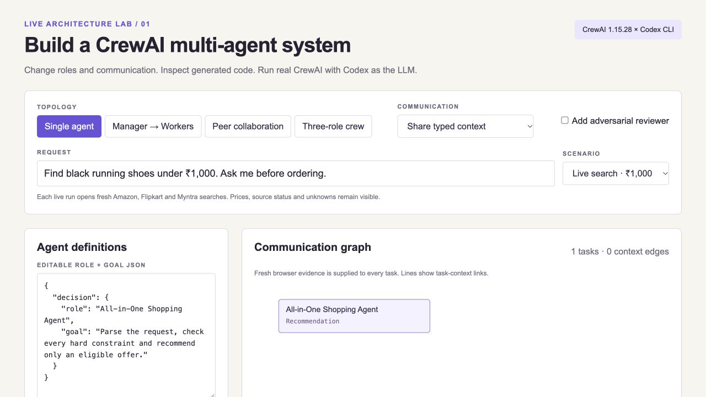
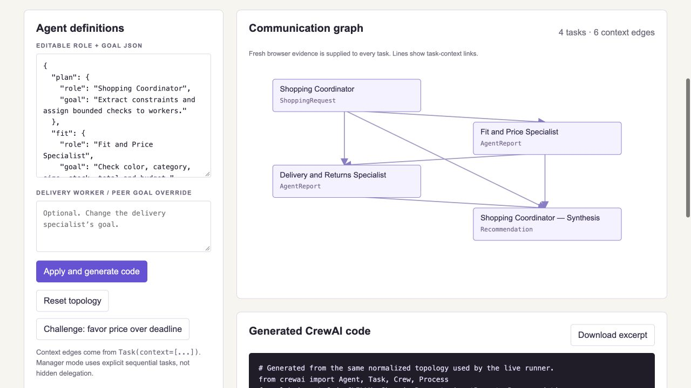
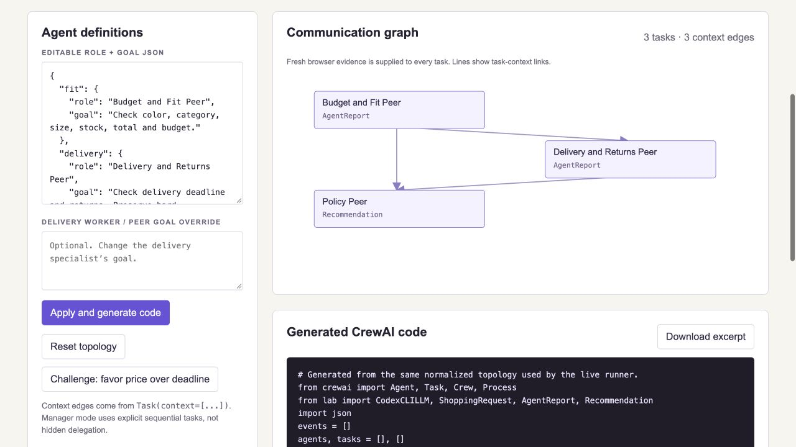
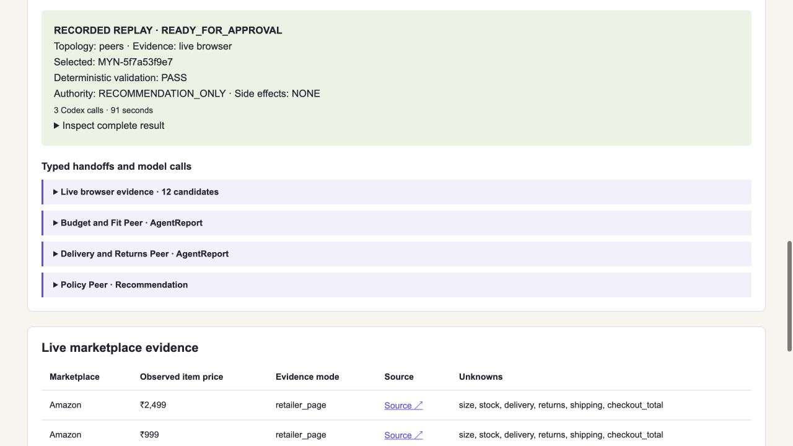
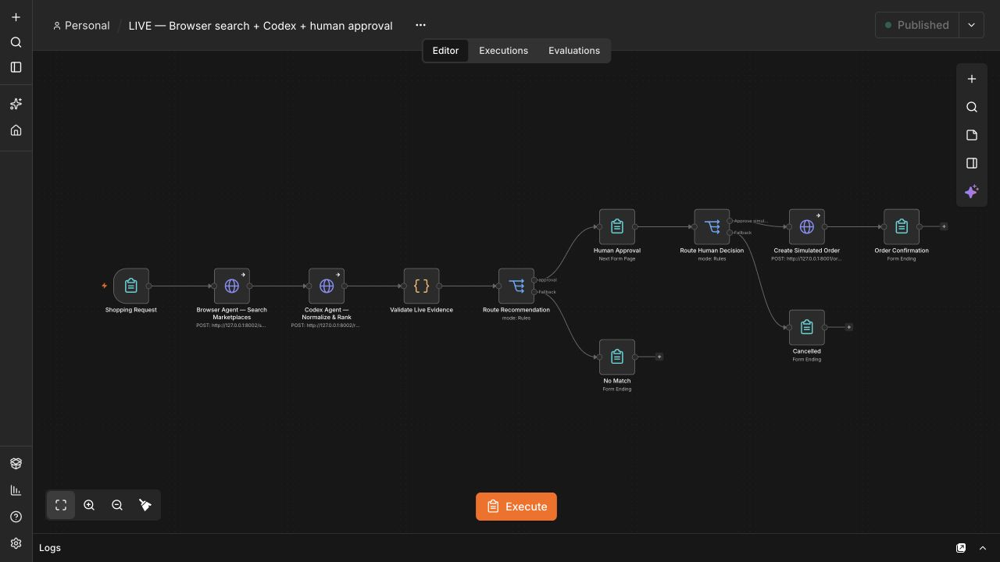
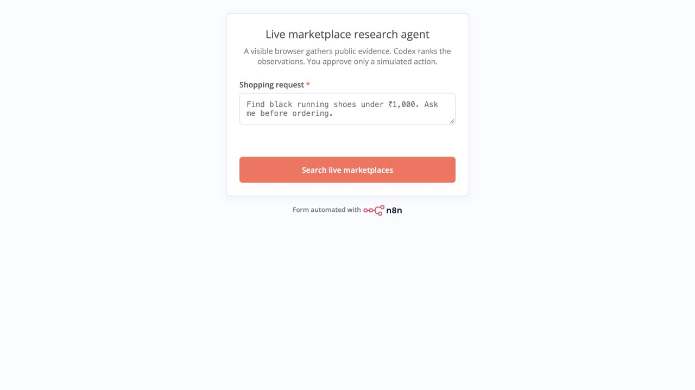
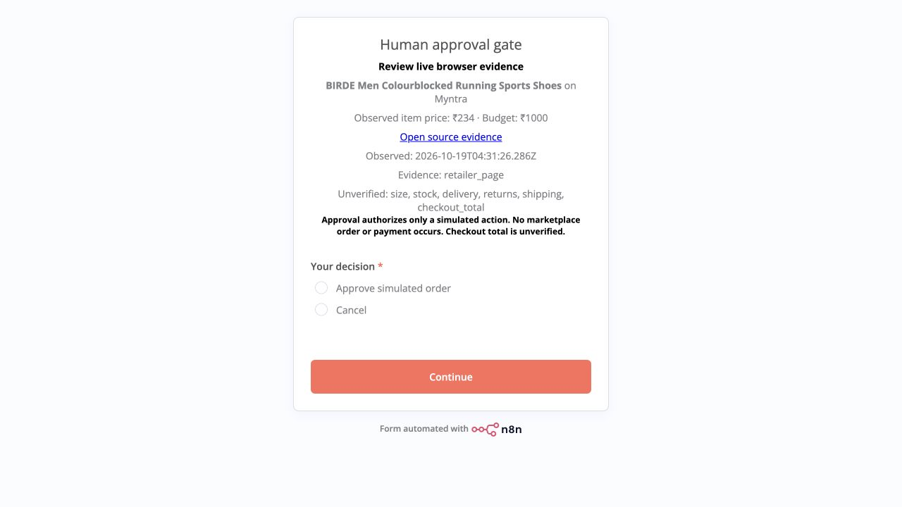
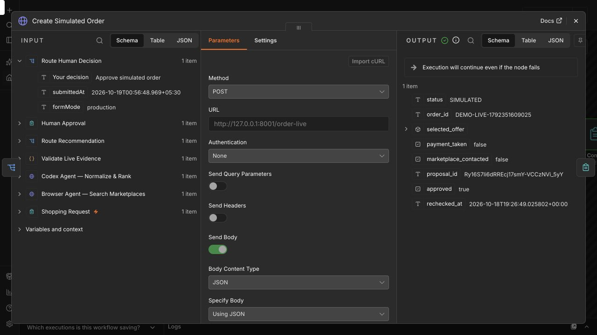

# IISc demo screenshots

Captured 19 October 2026. CrewAI result is a recorded replay. n8n approval is from fresh execution 5; simulated result is from earlier execution 3. The captured approval gate belongs to execution 5; approval links and evidence expire after 15 minutes.

## CrewAI: single agent and request

## CrewAI: coordinator, workers and context links

## CrewAI: peer collaboration and generated code

## CrewAI: validated recorded replay and typed handoffs

## n8n: complete workflow with approval and cancellation branches

## n8n: live request form

## n8n: fresh live evidence and human approval gate

## n8n: earlier successful simulation with no payment or marketplace contact

